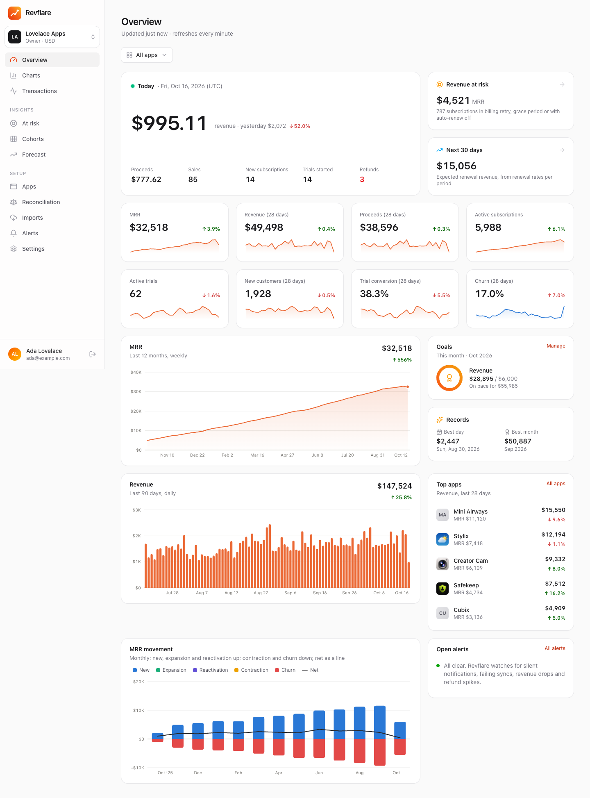
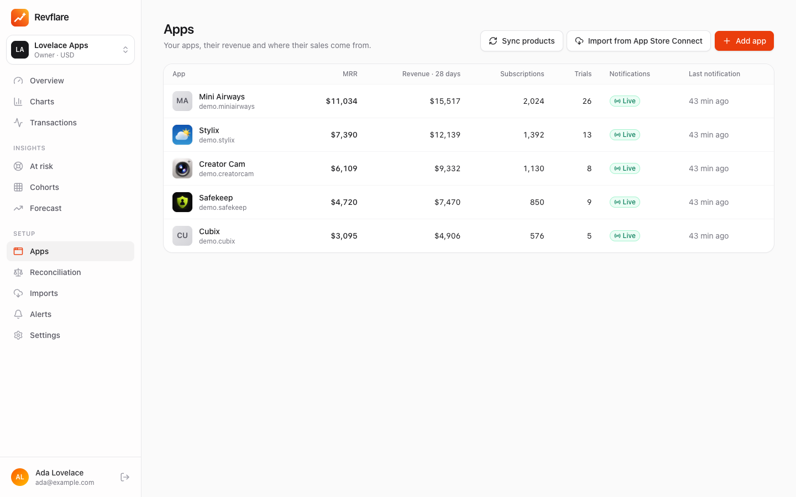
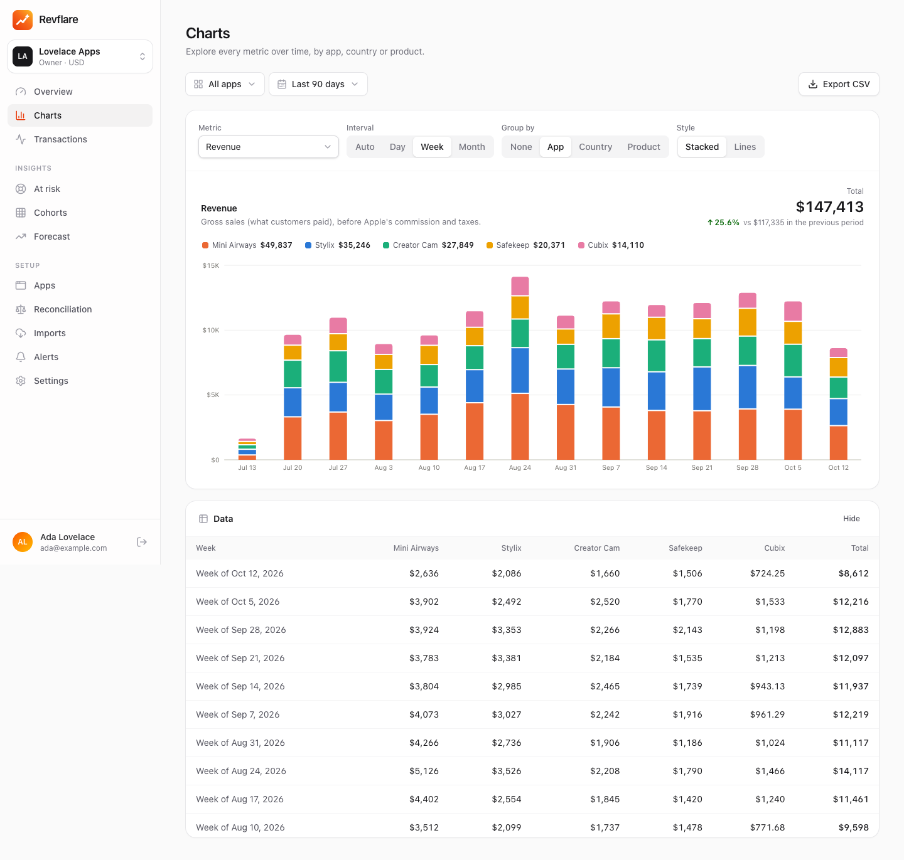
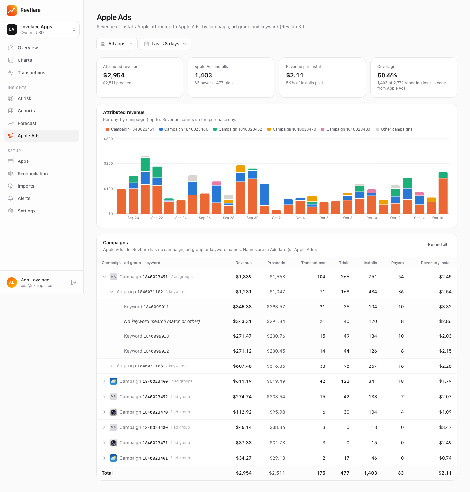
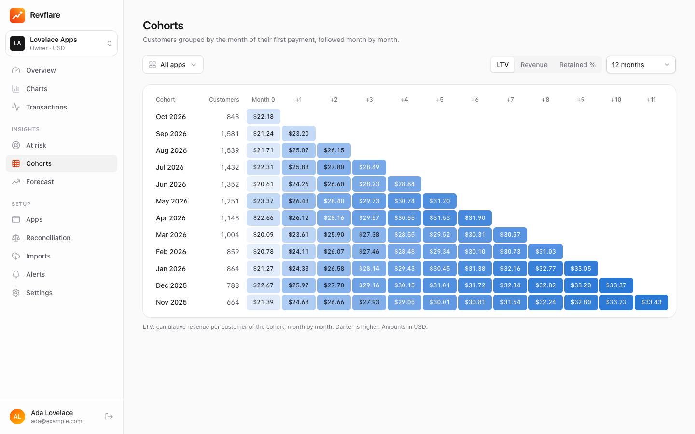
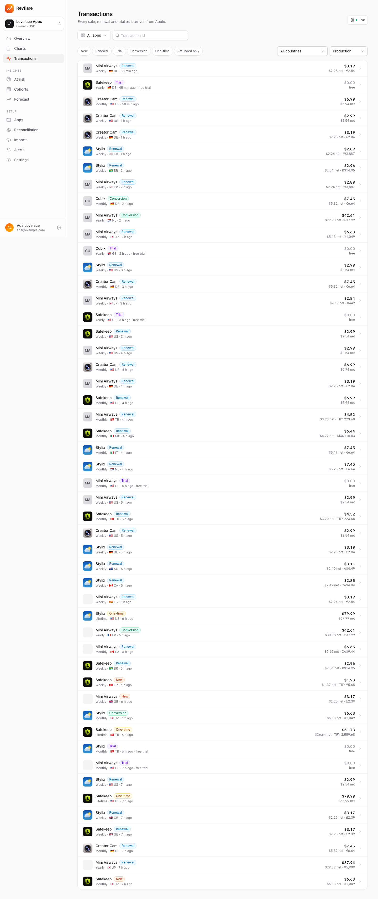

# Revflare

[](LICENSE)
[](https://github.com/FerdiKT/revflare/actions/workflows/ci.yml)

**Your App Store revenue, straight from Apple, on your own Cloudflare account.** Revflare is a self-hosted in-app
purchase and subscription revenue tracker: it listens to **App Store Server Notifications V2**, verifies every signed
transaction against Apple's root certificate and turns them into revenue, proceeds, MRR, churn, trials, cohorts and
forecasts. It runs **entirely on Cloudflare** (one Worker, a Durable Object SQLite database, R2 and Workflows), with no
servers to maintain, and fits the **Workers Free plan**.

It replaces the RevenueCat *dashboard* (not its SDK or paywalls): keep RevenueCat in your apps if you like, import its
history, and read every number from Apple. A native **iOS app** (widgets, Live Activity, a cash register sound on every
sale), an **MCP server**, a **CLI** and **RevflareKit** (Apple Ads attribution) come with it. Not affiliated with Apple
or RevenueCat.

[](https://deploy.workers.cloudflare.com/?url=https://github.com/FerdiKT/revflare)

## Screenshots

| Overview | Apps |
|---|---|
|  |  |
| **Charts** | **Apple Ads attribution** |
|  |  |
| **Cohorts** | **Transactions** |
|  |  |

All screenshots use synthetic demo data.

## Features

- **Apple is the source of truth**: App Store Server Notifications V2 arrive in seconds and every JWS chain is verified
  to the pinned Apple Root CA G3; every sale is keyed by Apple's transaction id, so nothing is counted twice. Apps whose
  notification URL already points elsewhere (e.g. RevenueCat) are polled through Notification History instead, and
  Revflare never replaces a notification URL without your consent.
- **Google Play (Android)**: real-time developer notifications (Pub/Sub push, OIDC-verified) completed with the Play
  Developer API: subscriptions, trials, renewals, upgrades, cancellations, grace / account hold, one-time products and
  refunds (voided purchases polled daily), with the exact proceeds of every order from the Orders API. Android apps sit
  next to iOS apps in every metric, the feed, customers, pushes and Meta sending. No history import yet. [Setup](docs/google-play.md).
- **One-click setup from App Store Connect**: import your apps, products and notification URLs with an App Store
  Connect API key; backfill 180 days of notifications and every customer's transaction history with an In-App Purchase
  key.
- **Metrics**: revenue and proceeds (Apple's commission, Small Business Program, taxes), MRR and ARR, MRR movement (new,
  expansion, contraction, churn, reactivation), active subscriptions and trials, trial conversion, churn, refunds, new
  customers, ARPU; per app, country and product, in your workspace currency (daily FX rates).
- **Insights**: revenue at risk (billing retry, grace period, auto-renew off), 30-day renewal forecast, cohorts and LTV,
  goals (named; revenue, proceeds, MRR, sales, new subscriptions, trials or actives; per week, month, quarter, year or
  custom dates; on all apps, some apps or all but some; pace, projection and a push when reached), record days, alerts (silent notifications, failing syncs, refund spikes, revenue drops).
- **Imports**: RevenueCat transaction ids (Apple fills in the details) and RevenueCat Charts daily history for the days
  before Revflare's own data; reconciliation against Apple's daily Sales and Trends reports.
- **iOS app** (`ios/`, SwiftUI, iOS 26): sign in by scanning a QR code, overview, charts, live feed, customers, push
  notifications for sales and refunds (with a cash register sound), Home / Lock Screen / StandBy widgets, Live Activity,
  Siri and Shortcuts, Face ID lock and a privacy mode.
- **Apple Ads attribution** with **[RevflareKit](sdk/ios/README.md)** (Swift package, no UI, no permission prompt):
  revenue, proceeds, installs and payers per Apple Ads campaign, ad group and keyword (with their names), the source of
  every sale in the feed, on the customer page and in sale notifications. Apple's test attribution (development /
  TestFlight builds) stays out of the totals. [Adsflare](https://github.com/FerdiKT/adsflare) reads it for ROAS and CAC
  and fills the campaign names.
- **LTV by acquisition source**: revenue and proceeds per install at D0, D7, D30, D90 and D180 per install cohort,
  Apple Ads vs organic, campaign, ad group, keyword or country, with immature cohorts flagged and coverage. [Definitions](docs/ltv.md).
- **Meta Ads (Conversions API)**: trials, purchases, trial conversions and renewals (also while the app is closed) go
  server-side to the app's Meta dataset as app events with their USD value, so Meta optimizes on real revenue. Matched
  through RevflareKit (Facebook SDK anonymous id, IDFA with ATT consent); per-event toggles and names, Sandbox / ATT
  switches, retries and a delivery log with the reason for every skipped event. [Guide](docs/meta-ads.md).
- **Apple refund requests**: answers Apple's `CONSUMPTION_REQUEST` notifications (Send Consumption Information) within
  the 12-hour window, with a per-app refund preference (none, decline after N days, prorated, full), the consent
  attestation Apple requires, per-customer opt-out, retries and a log. Prorated refunds only take their share out of
  revenue. [Guide](docs/refund-requests.md).
- **Promotional and win-back offers**: Revflare signs promotional offers for RevflareKit with the In-App Purchase key
  (legacy signature and JWS), only for the offers on the app's allowlist (import it from App Store Connect), with rate
  limits and an optional strict mode; lists lapsed subscribers (expired, auto-renew off) and counts promotional /
  win-back redemptions and their revenue per offer. [Guide](docs/offers.md).
- **Offerings and placements** (like RevenueCat offerings): the products each paywall shows (`$annual`, `$monthly` →
  App Store product ids, with free-form metadata JSON), the current offering and per-location placements, changed from
  the web app, the CLI (`revflare offerings <app> apply`) or the API without an app update; RevflareKit loads them.
- **Remote config** (like Firebase Remote Config): typed parameters (string, number, boolean, JSON) with values per
  condition (country / storefront, language, app version, OS version, percent rollout, testers, acquisition source:
  Apple Ads campaign / ad group / keyword vs organic, build: App Store / TestFlight / Xcode), resolved per device at
  the edge with no database read per launch; preview as any device, import a Firebase template, edit from the web app,
  CLI (`revflare config`) or API. [How it works](docs/remote-config.md).
- **A/B experiments** on remote config parameters (paywall, onboarding...): 2 to 5 variants with their own values,
  weights, targeting and traffic; devices are assigned at the edge (stable per install, no database work), RevflareKit
  reports exposures, and the results compare trial and paid conversion and revenue per install of the exposed installs
  (Bayesian probability to be best, lift vs control with a 95% interval, guardrails before a winner); roll out the
  winner as the new defaults in one click. [How it works](docs/experiments.md).
- **Events and funnels**: RevflareKit sends app events (`Revflare.track`) to Cloudflare Workers Analytics Engine, and
  key events (first open, purchases, paywall views, onboarding, experiment exposures) to the database too, so funnels
  and experiments count every install exactly instead of WAE's samples; the web app, CLI and MCP show top events and funnels (onboarding → paywall → trial / paid, with Revflare's
  own sales as steps): users, conversion, drop-off and median time per step, by app version, country or a property.
  Sandbox / Xcode builds and test devices are left out of events, funnels, experiments, LTV and attribution unless you
  ask for test data. [How it works](docs/funnels.md).
- **Funnel alerts and daily digest**: alerts (and pushes) when an app stops sending events, when yesterday's funnel
  conversion drops significantly against the 14 days before and the same weekday, or when a new app version converts worse than the previous
  one (per funnel: on / off, high / normal / low sensitivity); the morning summary adds installs and trials, and an
  optional daily digest email covers every app. [Alerts](docs/funnels.md#alerts).
- **App Store acquisition** from Apple's App Analytics reports: impressions, product page views, downloads, conversion
  and App Store purchases by source type (search, browse, web / app referrer), referrer and campaign token (`ct=` links).
- **Workspaces and roles**: one deployment for several teams; owner, admin and viewer roles; invitation links. Instance
  admins get an **Admin** area: overview (version, jobs, database usage), users, workspaces, invitations and settings.
  Optional **sign-in links by email** through Cloudflare Email Sending (off until an instance admin turns them on).
- **For AI agents**: REST API (`/api/v1`) with per-workspace API keys, a built-in **MCP server** (`/mcp`) and the
  **`revflare` CLI** with a Claude Code skill.

## Deploy

Requirements: a Cloudflare account (the Free plan is enough; R2 must be enabled on the account), Node.js 22.12+.

```bash
git clone https://github.com/FerdiKT/revflare.git
cd revflare
npm install
openssl rand -base64 32 | npx wrangler secret put SECRET_KEY    # recommended: encrypts stored App Store / RevenueCat keys
openssl rand -base64 24 | tee /dev/stderr | npx wrangler secret put SETUP_TOKEN   # optional: protects the first sign-up
npm run deploy
```

Or use the **Deploy to Cloudflare** button above (it creates the R2 bucket, the Durable Object and the Workflow for
you). Then open the URL and create the first account (it becomes the instance admin; enter the `SETUP_TOKEN` if you
set one). The database schema is applied automatically, and the cron trigger arms itself.

**Sign-in links by email** (optional, needs **Workers Paid** and a domain onboarded to Cloudflare Email Sending:
`npx wrangler email sending enable example.com`): add `"send_email": [{ "name": "EMAIL", "remote": true }]` and the
variable `EMAIL_FROM = "Revflare <revflare@example.com>"` to `wrangler.local.jsonc`, deploy, then turn on **Admin →
Settings → Sign-in links by email** (off by default; "Send test email" checks the setup). The sign-in page then offers
"Email me a sign-in link instead": a one-time link, valid for 15 minutes. On the Workers Free plan the binding only
delivers to your account's verified Email Routing destination addresses, so links would not reach other users.

**Custom domain and personal settings**: copy `wrangler.local.example.jsonc` to the git-ignored `wrangler.local.jsonc`
and edit it (routes, `PUBLIC_URL`, APNs vars). `npm run dev` / `npm run build` / `npm run deploy` use it when it exists.

### Connect the App Store

1. In App Store Connect → Users and Access → Integrations, create an **App Store Connect API key** (App Manager role;
   add the Sales role and your vendor number for Sales and Trends reconciliation) and an **In-App Purchase key**.
2. Revflare → Settings → **Store credentials**: add both (key id, issuer id, `.p8` contents). They are stored encrypted.
3. Revflare → **Apps** → *Import from App Store Connect*. Apps without a notification URL get Revflare's (production and
   sandbox, Version 2) and go live at once; apps whose URL points elsewhere are polled through Notification History
   (or switch them with *Connect notifications to Revflare* on the app's page). *Imports* backfills history.

### Connect Google Play (optional, Android apps)

1. Revflare → **Apps** → *Add Android app* (name + package name), or `revflare apps add-android "Example" com.example.app`.
2. Follow the app's **Google Play** page ([docs/google-play.md](docs/google-play.md)): a Google Cloud service account
   with a JSON key (invited in Play Console with "View financial data, orders, and cancellation survey responses"), a
   Pub/Sub topic Google Play publishes to, a push subscription to the app's RTDN URL (with authentication), the topic in
   Play Console → Monetization setup, then *Send test notification*.

### iOS app and push (optional)

Build the app from `ios/` with your own bundle id and team ([ios/README.md](ios/README.md)). For push notifications
create an APNs key (Apple Developer → Keys), set `APNS_KEY_ID`, `APNS_TEAM_ID` and `APNS_TOPIC` (your app's bundle id) in
`wrangler.local.jsonc` and `npx wrangler secret put APNS_PRIVATE_KEY`. Then Settings → **iOS app** shows a QR code to
sign in on the phone. Once the app is signed in, it can sign browsers in: the sign-in page shows **Sign in with the iPhone app**
(a QR code to scan in the app or with the camera, or, with APNs, a push where you pick the number shown in the
browser; approved with Face ID). The optional `APP_STORE_URL` var adds a "Get the app" link there.

### Apple Ads attribution (optional)

Add [RevflareKit](sdk/ios/README.md) to your apps and call
`Revflare.configure(sdkKey: "rfp_…", server: URL(string: "https://revflare.example.com")!)` at launch (the key is on
the app's page). Revenue per campaign, ad group and keyword appears under **Apple Ads**; purchases show their source in
the feed and on the customer page. Apple only gives ids: a connected Adsflare fills the names, or import them under
**Apple Ads → Names** (CSV / TSV `kind,id,name` or JSON) or with `revflare attribution names import <file>`.

### Meta (Facebook) ads (optional)

1. In [Meta Events Manager](https://business.facebook.com/events_manager2) create (or pick) the app's dataset, then
   dataset → **Settings** → **Conversions API** → **Generate access token**.
2. In Revflare: the app's page → **Integrations → Meta Ads**: enter the dataset id and the token (stored encrypted,
   never shown again), optionally a test event code, choose the events and their names, and turn it on. Turning it on
   queues the purchases of the last 7 days. **Send test event** checks the setup; the delivery log shows every event
   sent, skipped (with the reason) or refused by Meta. The CLI has the same: `revflare meta <app> ...`.
3. In the app: [RevflareKit](sdk/ios/README.md#meta-facebook-ads) reports the install's identifiers (Facebook SDK
   anonymous id, IDFA when the user allowed tracking); purchases must be linked to the install
   (`appAccountToken` = `Revflare.installId`, or RevflareKit's transaction reports). Turn off the Facebook SDK's
   automatic purchase logging, otherwise Meta counts purchases twice.

Details (event mapping, ATT rules, testing, troubleshooting, privacy): [docs/meta-ads.md](docs/meta-ads.md).

### Apple refund requests (optional)

Needs the app's notifications to come to Revflare (not polled from another server). The app's page → **Integrations →
Refund requests**: confirm that you obtained your customers' consent to share consumption data with Apple, pick a
refund preference and turn it on. Every request and Revflare's answer shows in the log. CLI: `revflare refunds <app>`.
Details: [docs/refund-requests.md](docs/refund-requests.md).

### Promotional offers (optional)

Add an In-App Purchase key (Settings → Store credentials), then the app's page → **Paywalls and remote config → Offers**: list
the promotional offers RevflareKit may get a signature for (or import them from App Store Connect). CLI:
`revflare offers <app>`. Details: [docs/offers.md](docs/offers.md).

### Offerings and paywalls (optional)

The app's page → **Paywalls → Offerings**: create offerings (packages such as `$annual` / `$monthly` pointing at the
app's App Store products, ordered, with metadata JSON your paywall reads), make one **current**, and map placements
(paywall locations such as `onboarding`, `settings`) to an offering or to the current one. The page shows the exact JSON
apps get. [RevflareKit](sdk/ios/README.md) fetches it from `GET /sdk/v1/offerings` at launch (cached at the edge, ETag
revalidation, so it costs no database read per launch); changes reach apps within a minute. From the terminal:
`revflare offerings <app> export > offerings.json`, edit, `revflare offerings <app> apply offerings.json`. API:
[docs/api.md](docs/api.md#offerings-and-placements-paywalls).

### Remote config (optional)

The app's page → **Paywalls and remote config → Remote config**: add parameters (`onboarding_version`, `max_free_accounts`,
`paywall` JSON...) with a default and values per condition, and order the conditions (country picker, language, app
version, percent rollout, tester install ids). **Preview as** shows what a device in a given country / version / locale
gets; **Import from Firebase** takes the template from `firebase remoteconfig:get -o template.json` (dry run first; what
cannot be converted is listed). [RevflareKit](sdk/ios/README.md) fetches the device's values from `GET /sdk/v1/config`
(evaluated in the Worker from a cached copy: no database read per launch). From the terminal: `revflare config <app>`,
`revflare config <app> eval --country CN`, `revflare config <app> set <key> <value> [--condition <name>]`. Details:
[docs/remote-config.md](docs/remote-config.md); API: [docs/api.md](docs/api.md#remote-config-like-firebase-remote-config).

### Experiments (optional)

The app's page → **Paywalls and remote config → Experiments**: pick remote config parameters, give each variant (A is the
control) its values and weight, optionally a targeting condition and a traffic percentage, and a primary metric (trial
started, paid, revenue per install); start it. Devices get their variant from `GET /sdk/v1/config`;
[RevflareKit](sdk/ios/README.md) 1.7+ sends an `experiment_exposure` event when the app reads one of its parameters, so
results need [events](#events-and-funnels-optional) set up. The results page shows exposed installs, trial and paid
conversion, revenue per install, the probability to be best and the lift against the control, and says "not enough data"
until 7 days, 100 exposed installs per variant and 10 conversions. Stop it, then roll out the winner (its values become the
defaults) or archive it. From the terminal: `revflare experiments <app>`, `revflare experiments <app> results <id>`.
Details: [docs/experiments.md](docs/experiments.md); API: [docs/api.md](docs/api.md#experiments-ab-tests-on-remote-config).

### Events and funnels (optional)

[RevflareKit](sdk/ios/README.md) sends app events (`Revflare.track("paywall_view", ["placement": "onboarding"])`) to
`POST /sdk/v1/events`; Revflare writes them to a [Workers Analytics Engine](https://developers.cloudflare.com/analytics/analytics-engine/)
dataset; key events (`first_open`, `purchase_*`, `restore_*`, `paywall_view`, `paywall_close`, `onboarding_*`,
`experiment_exposure` and patterns you add per app) are also stored in the database, so funnels, experiment exposures,
alerts and the Events page count them exactly (about 3 rows written per key event, capped per install, per app and day
and by the daily background budget; other events cost no database work). The app's page → **Events** lists top events;
**Funnels** shows where users drop off; **Key events** sets the extra patterns, daily cap and retention
([docs/funnels.md](docs/funnels.md#exact-key-events)). Setup:

1. The binding is in `wrangler.jsonc` (copy it to your `wrangler.local.jsonc`):
   `"analytics_engine_datasets": [{ "binding": "EVENTS", "dataset": "revflare_events" }]`. The dataset is created on the
   first write. Without the binding, apps still get `200` and the events are dropped.
2. Reading them uses the Analytics Engine SQL API: add your account id as a var, `"CF_ACCOUNT_ID": "<32 hex characters>"`
   (dashboard → Workers & Pages, right column), and an API token with **Account → Account Analytics → Read** as a secret:
   `npx wrangler secret put CF_ANALYTICS_TOKEN`. Deploy. The Events page says what is still missing.

Costs: Workers Paid includes 10 million data points and 1 million read queries a month, then $0.25 per additional
million data points (one data point per event); the Free plan allows 100,000 data points a day. Events are kept 3 months. Queries are cached 5 minutes. When an app sends a lot, Analytics Engine
samples (counts are weighted; funnel user counts become lower bounds, marked approximate) — except key events, read
from the database once they cover the range (marked exact). [docs/funnels.md](docs/funnels.md),
API: [docs/api.md](docs/api.md#events-and-funnels-revflarekit-events-workers-analytics-engine).

### App Store acquisition (optional)

Revflare asks Apple for each app's App Analytics reports (one ongoing report request per app: **Acquisition** →
*Request reports*, or `revflare acquisition requests`). Creating the requests needs an App Store Connect API key with the
**Admin** role; reading the reports works with **Sales and Reports**, so a Sales key can be added as a separate
*App Store Connect reports key* (also used for Sales and Trends). Apple delivers the first reports 1–2 days later; the
cron then imports new days every few hours. Campaign links (`https://apps.apple.com/app/id<APPID>?pt=<provider
token>&ct=<campaign>`) appear under Campaign; Apple leaves out referrer / campaign rows with fewer than 5 users.

## Use it with AI agents

**MCP** (Claude Code, Claude Desktop, Cursor...): create an API key in Revflare → Settings → API keys, then

```bash
claude mcp add --transport http revflare https://<your-revflare>/mcp --header "Authorization: Bearer rf_..."
```

and ask things like *"how much did we make this month, by country?"*. Tools: overview, apps, charts, breakdowns, MRR
movement, transactions, customers, at risk, forecast, cohorts, reconciliation, daily and attributed revenue, App Store acquisition, alerts.

**CLI** (`revflare`; Node 20+, no dependencies):

```bash
npm run cli:build && npm i -g ./cli            # from a clone
revflare login --url https://<your-revflare>   # asks for the API key
revflare overview
revflare chart mrr --range 12m --interval month
revflare breakdown --by country --metric revenue
revflare transactions --follow
revflare skill install                         # Claude Code skill (skills/revflare/SKILL.md)
```

Every command takes `--json`. See [cli/README.md](cli/README.md) and the REST reference in [docs/api.md](docs/api.md).

## Updating

Admin → Overview shows the running version and, once a day, checks GitHub for a newer release (one request; instance
admins see "Update available"). Set the variable `UPDATE_CHECK = "false"` to turn that off, or
`UPDATE_REPO = "owner/name"` to follow a fork. Read the [release notes](CHANGELOG.md) first, then:

- **Deployed from a clone**: `git pull && npm ci && npm run deploy` (keep your settings in `wrangler.local.jsonc`).
- **Deployed with the Deploy to Cloudflare button**: your copy of the repository has a *Revflare update* workflow
  (`.github/workflows/revflare-update.yml`) that opens a pull request with each new release, weekly or when you run it
  from the Actions tab. Merging it deploys the update (Workers Builds). It never touches your `wrangler.jsonc`,
  `wrangler.local*.jsonc`, `.dev.vars*` or workflow files, and lists upstream `wrangler.jsonc` changes to copy by hand.
  Allow it to open pull requests (Settings → Actions → General → *Allow GitHub Actions to create and approve pull
  requests*); otherwise it opens an issue with a link to the prepared branch.

Database migrations run automatically when the database object starts after the deploy (it can keep running the
previous code for a few minutes).

## How it runs on the Free plan

- **One Worker** serves the React app, the REST API, the MCP server, Apple's notifications and RevflareKit reports.
- **The database is SQLite inside one Durable Object** (`RevflareDatabase`); heavy work (JWS verification, syncs,
  rollups) runs inside it, where it gets 30 s of CPU instead of the Worker's ~10 ms. Binding a D1 database as `D1`
  switches to D1 without code changes.
- **Free plan database budget** (5M rows read / 100k written a day): metrics are precomputed incrementally, reads are
  cached, and background work (imports, backfills, history syncs, stored key events) has its own capped daily budget, so new sales and
  dashboards keep working. Settings → Usage shows the numbers; on Workers Paid raise the caps with
  `BACKGROUND_READS_PER_DAY` / `BACKGROUND_WRITES_PER_DAY`.
- **One cron trigger** (every 5 minutes; Free accounts share five) picks its work by slot and stays under the
  subrequest limit: rollups, Notification History polling, transaction history backlogs, alerts, FX rates, Sales
  reports and the daily update check. Long imports run as **Workflows**, one bounded step at a time.
- **R2** keeps the raw signed notifications. Secrets at rest (App Store keys, RevenueCat keys) are AES-GCM encrypted
  with `SECRET_KEY`.

## Development

```bash
npm run dev          # Vite + Cloudflare plugin: local Worker, Durable Object database, R2, Workflows
npm run typecheck
npm test             # unit tests, CLI tests and integration tests in workerd
```

With `DEV_SEED=true` in `.dev.vars`, `POST /api/v1/dev/seed` fills the current workspace with a year of synthetic sales.
See [CONTRIBUTING.md](CONTRIBUTING.md) for the project layout, the Free plan budget and commit conventions, and
[CLAUDE.md](CLAUDE.md) for the rules the code follows.

## Roadmap

Revflare stays small on purpose: App Store and Google Play revenue, subscriptions and Apple Ads attribution. These are added when
someone needs them — open an issue if you do:

- Google Play history import (Play financial reports) for the time before setup
- Web payments: Stripe, Polar
- Attribution partners (AppsFlyer, Adjust) and outgoing webhooks / integrations

## Security

Please report vulnerabilities privately; see [SECURITY.md](SECURITY.md), which also lists how to harden an instance.

## License

Source available under the [PolyForm Noncommercial License 1.0.0](LICENSE): free for personal, noncommercial and
evaluation use; commercial use (tracking the revenue of apps that earn money, companies, agencies) needs a commercial
license ([buy one](https://revflare.ferdi.app/buy)), see [COMMERCIAL-LICENSE.md](COMMERCIAL-LICENSE.md). The SDKs that ship inside apps are [MIT](sdk/ios/LICENSE)
and free for any use: RevflareKit for iOS in `sdk/ios` (published as
[FerdiKT/RevflareKit](https://github.com/FerdiKT/RevflareKit)) and for Android in `sdk/android`. App Store, App Store Connect and Apple Ads are trademarks of Apple Inc.; RevenueCat is a
trademark of RevenueCat, Inc. Revflare is an independent project.
